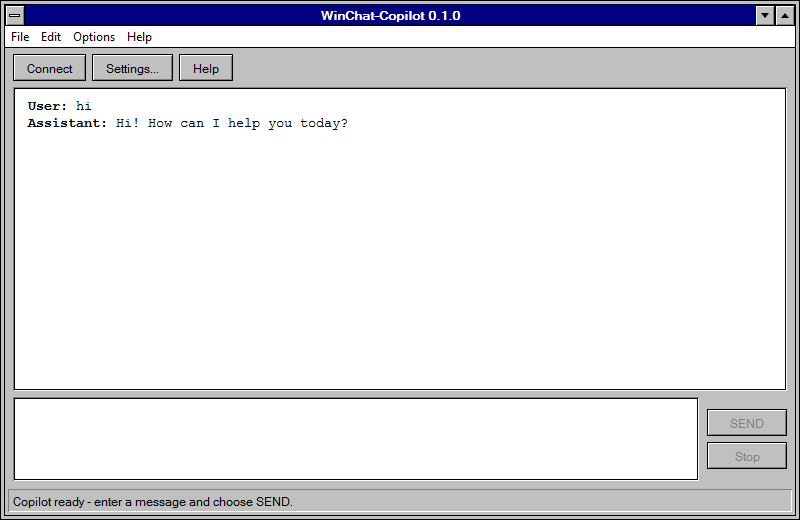

# win95-copilot



## Application scaffold

The bootstrap uses **WPF on .NET 10 LTS**. WPF supplies a lightweight,
unpackaged Windows executable, XAML controls, and ordinary Windows keyboard and
window behavior without requiring the Windows App SDK. Its styling and window
customization support the Windows 3.1 shell without Windows App SDK packaging.
The reference-led [Windows 3.1 shell](docs/windows31-shell.md) supplies menus,
text areas, action surfaces and a versioned About dialog. Backend discovery,
configuration, preference persistence and authenticated text-only readiness
are implemented. SEND now streams a text-only chat turn into the transcript.
Keyboard send modes, Edit actions and transcript preferences are implemented.
Clear Window safely settles active work and prepares a new conversation.
File > Save Transcript exports the current conversation as UTF-8 plain text.

### Prerequisites

- Windows 10 (for example, Enterprise LTSC 2021/21H2) or Windows 11, on a version supported by the
  [.NET Windows OS policy](https://github.com/dotnet/core/blob/main/release-notes/10.0/supported-os.md).
  Ordinary Windows 10 22H2 is no longer listed as supported by .NET 10.
  .NET does not extend the operating system's lifecycle.
- The latest serviced **.NET 10 SDK** for development and tests. `global.json`
  accepts stable 10.0 SDK feature bands starting at 10.0.100.
- **PowerShell 7** for publishing and opt-in/safe-output script regressions
  (standard installation or Windows app-execution alias; included on Windows CI).
- The **.NET 10 Desktop Runtime** for running a framework-dependent build on a
  machine without the SDK. The SDK includes the development/runtime components.
- Internet access to NuGet for the first test dependency restore. Copilot
  installation, authentication, and inference access are not required.

.NET 10 LTS is supported through November 14, 2028 under Microsoft's
[support policy](https://dotnet.microsoft.com/en-us/platform/support/policy/dotnet-core);
keep SDK/runtime patches current. .NET 8 was not selected because its support
ends November 10, 2026. WPF is Windows-only. There is no hard 50 MB memory gate;
UI-process and backend-process memory will be measured separately in the final
packaging task.

### Local commands

Run these PowerShell commands from the repository root:

```powershell
dotnet restore .\WinChatCopilot.sln
dotnet build .\WinChatCopilot.sln --configuration Release --no-restore
dotnet test .\WinChatCopilot.sln --configuration Release --no-build --no-restore
dotnet run --project .\src\WinChatCopilot\WinChatCopilot.csproj --configuration Release --no-build --no-restore
```

The run command displays the retro shell and the application version in its
title. Close it with File > Exit, system-menu Close, or Alt+F4; there is no
dedicated X button. The [reference/appearance checklist](docs/windows31-shell.md)
is optional human review guidance, not a delivery gate. Automate feasible checks
with synthetic data and isolated settings. Local interactive testing is authorized
for verified run-owned app windows only; do not interact with unrelated windows.
The scaffold tests load window resources on a dedicated STA thread without
showing a window and verify the displayed version against generated metadata.
The deterministic fake-CLI suite and Windows CI are described below. Neither
requires Copilot installation, authentication, or service access.

### Backend configuration and preferences

Settings/Options > Backend Settings accepts an absolute executable path or a
blank field for automatic discovery. Discovery takes the first `copilot.exe`
on PATH (quoted entries supported), then checks GitHub.Copilot portable-package
directories in the documented default WinGet user/machine package roots.
Custom installations require PATH or explicit selection. An invalid explicit
path is never silently replaced. The [installation evidence and readiness
contract](docs/copilot-cli-contract.md#application-discovery-and-readiness)
describe the supported version and limits.

Preferences live in `%LOCALAPPDATA%\WinChatCopilot\settings.json`. Defaults:
Ctrl+Enter send mode, Word Wrap off, Auto-connect off, Show Timestamp off,
automatic executable discovery. Menu check states and input/display behavior
use these persisted preferences. Backend Settings preserves these fields. Corrupt,
unreadable and unwritable files produce actionable errors; writes replace the
previous file only after the new document has been written successfully.
No credentials are collected or saved.

With Auto-connect off, startup still discovers the backend and shows configuration
guidance when it is missing/invalid, but performs no service request. Connect
manually checks the bundled version, then sends one small synthetic text-only
readiness request using existing CLI authentication. Auto-connect performs the
same check at startup. Readiness requires a successful service response, matching
new session identity and zero-tool evidence, not just installation or `gh` login.
It does not imply permanent connectivity. SEND is enabled only while ready
with non-whitespace input and no request running.
Initial Connect prepares a session. Once a session exists, explicit Connect
checks the same identity without retrying the user's prompt or silently
discarding context. A failed recovery remains unavailable with an actionable
error. Changing executables after connecting is rejected with restart guidance;
Clear Window explicitly retires the session and prepares a fresh one. No automatic retry occurs.
Closing during preparation cancels and settles only the owned subprocess.

The CLI uses app-isolated `cli` and `work` directories beside settings so
readiness does not load or modify the user's CLI settings/conversations.
Existing OS-stored CLI authentication or supported inherited token environment
variables must already be available; authenticate separately if needed.
`WINCHAT_DATA_DIRECTORY` can select an absolute isolated app-data directory for
tests; it must never point at real user data during automated verification.

### Distribution and packaged verification

The [user guide](docs/user-guide.md) documents extraction, Windows/runtime/CLI
prerequisites, authentication, menus, local data and truthful limitations.
`scripts\Publish-App.ps1 -OutputDirectory 'C:\builds\winchat-0.1.0'` produces a
Release/win-x64 framework-dependent folder, zip and SHA-256 manifest in a new
absolute directory. Add `-SelfContained` to bundle .NET 10 Desktop Runtime;
otherwise users need that x64 runtime. No installer/signing/store publication
or Copilot installation is performed. All extracted files must remain together.

`scripts\Test-PackagedApp.ps1` runs opt-in owned-window desktop checks against
an already published executable and actual synthetic subprocess helper. It
requires Windows PowerShell 5.1/STA for the OS UI Automation assemblies.
Results distinguish actual packaged interaction from deterministic/resource
tests and real-service evidence. See [packaged verification](docs/packaged-verification.md)
for commands, coverage and revision-specific evidence expectations.

### Project layout and version

`src\WinChatCopilot` contains the WPF entry point, shared retro window/control
resources, shell commands, main window and About dialog.
`tests\WinChatCopilot.Tests` contains xUnit tests with a reference to the app;
later tasks can add UI-independent logic and actual subprocess tests without a
separate speculative service architecture.

**Application version has one source:** `Version` in `Directory.Build.props`.
MSBuild generates assembly/file/informational metadata from it; the window uses
that metadata through `ApplicationInfo.Version` (without a source-commit suffix).
Change the property rather than adding a separate UI version constant.

## Deterministic process tests and Windows CI

The same restore/build/test commands above run scaffold checks and the
`ProcessTransportTests` suite. The solution builds the small
`tests\WinChatCopilot.FakeCli` console executable and copies its apphost/runtime
files into the test output's `Fake CLI` directory (intentionally containing a
space). Tests launch that actual executable through production
`src\WinChatCopilot\Processes\ProcessTransport.cs`, never a mocked transport,
shell, or real `copilot.exe`. Fixtures use synthetic prompts/session IDs and
unique temporary working directories; helper PATH is empty and credential
environment variables are removed.

The transport uses `ArgumentList`, closed stdin and independently drained,
strict UTF-8 stdout/stderr. Callbacks receive raw character chunks, not lines;
concatenation preserves multiline/Unicode text even when UTF-8 bytes arrive
separately. Callbacks on the two streams can overlap and must not block or
assume cross-stream ordering. Nonzero OS exit codes are returned explicitly;
launch, encoding, callback and cleanup errors propagate. Caller cancellation
throws only after owned work settles, preserving chunks already delivered.
Terminal escape sequences are deliberately still raw here: the later CLI
adapter owns response framing, diagnostic filtering and terminal sanitization,
and must reuse this exercised transport rather than create another one.

Scenarios cover gated progressive output without newline boundaries, split
UTF-8/multiline output, stdout/stderr and terminal formatting separation,
stderr backpressure, clean/nonzero/partial-failure exits, silent stalls, cancellation before/after
output, an owned child and an unrelated sentinel, invalid encoding and failed
consumers. Argument/session assertions round-trip quotes, metacharacters,
newlines, Unicode, empty arguments and trailing backslashes. Deliberately
incorrect session/prompt scenarios demonstrate that these assertions fail.
These are synthetic transport tests, **not real Copilot compatibility,
authentication, persisted session history, or UI behavior evidence**.

Each fixture has a 30-second test safety bound, readiness gates have ten-second
bounds, and cancellation/process-tree exit has a ten-second cleanup bound.
Tests explicitly await termination and check owned parent/child handles while
an unrelated sentinel remains alive. Stalled helpers also self-expire after
30 seconds in their stall, with separate ten-second readiness gates;
fixture teardown cancels pending work and deletes only its
unique temporary directory. These are runner/cleanup bounds, **not a production
inference timeout policy**. Tree termination uses .NET's owned process handle
while the parent is alive; detached/reparented children are not a guaranteed
supported backend contract. Do not use process-name kills.

`BackendTests` adds isolated executable/PATH/WinGet-root discovery, complete
preference round trips and invalid/locked/read-only settings, actual fake-CLI
readiness subprocesses (including malformed/version/auth/tool/session failures),
owned cancellation, startup Auto-connect/manual reconnect, and bounded STA
startup/settings command/dialog checks. These synthetic tests run in the same
Windows CI without real credentials or inference; they are not real CLI evidence.

`ChatTests` exercises the production adapter through the same actual fake
executable: JSON events split across pipe reads, split UTF-8, gated text before
exit, multiline text, terminal CSI/OSC/control-string filtering across delta
boundaries, ignored diagnostic events, exact prompt arguments, zero-tool checks,
matching successful session results and explicit malformed/partial failures.
Bounded STA/dispatcher tests cover progressive transcript output, responsiveness,
single-flight SEND, input retention, modal errors and owned generation shutdown.
WPF test classes share one xUnit collection to avoid concurrent mutation of
WindowChrome's process-wide property-descriptor caches; transport tests remain
independent.
These are synthetic application tests, not real-service or visual acceptance.

### Streamed chat

Connect establishes the supported text-only backend, then choose SEND to submit
the input as one argument without a shell. Input is read-only while generating,
and connection/settings actions are unavailable. The original input is cleared
only after a complete successful response; failures retain it and any partial
assistant output, add a visible `[Failed]` marker, and display an actionable
retro error dialog. No automatic retry occurs. Connect explicitly verifies the
same backend session after failure; Clear Window prepares a new conversation.
Each turn stores submission/finish timestamps and generating/completed/failed/
cancelled state for later transcript/export features.

Only assistant response text enters the read-only monospaced transcript with
User/Assistant labels. The adapter incrementally frames UTF-8 JSONL, strips
terminal formatting without losing meaningful newlines/Unicode, and accepts
completion only with successful OS exit, empty stderr, matching session result,
zero-tool model evidence and final text matching the deltas. Final-only text is
supported without duplicating it. Events, raw response text and stderr each have
a 1 MiB safety bound; this limits memory, not request duration or provider latency.
The shared readiness/request builder retains all verified text-only restrictions.

Stop cancels the owned request, displays Cancelling and disables submission and
settings until work settles. Partial output and the original input remain,
with a visible `[Cancelled]` marker and a reminder to review input before any
explicit next SEND. The same backend session remains usable under the verified
bundled-CLI cancellation contract; local termination does not guarantee remote
work/billing stops or all partial history is persisted. A failed turn retains
its session identity but requires explicit Connect to verify recovery. Neither
Stop nor Connect automatically resubmits an accepted prompt.

File Exit, system-menu close, Alt+F4 and window closing share one lifecycle path.
Repeated close requests cannot bypass settlement. Active request identities
guard backend callbacks and queued UI updates so retired requests cannot mutate
later turns or a closed window. Existing owned process-tree transport and its
ten-second cleanup safety bound are reused; no unrelated Copilot process is
terminated. The consciously deferred production stall/watchdog policy is
unchanged: a silent request remains generating until Stop or Exit; test bounds
are not production latency guarantees.

File > Clear Window works while idle, generating, or cancelling. It disables SEND,
connection changes and repeated resets, cancels and settles owned generation,
then clears the transcript and prepares a different backend session identity.
Unsent/cancelled input is preserved for review, not automatically submitted.
Failed preparation leaves an empty transcript and no accepted session; Connect
can explicitly prepare a fresh conversation but never falls back to old context.
Exit during reset settles preparation before closing. Ordinary SEND follow-ups
and explicit recovery continue the same session. No conversation is restored
after application restart.

The user-approved real failure/stall evidence deferrals remain unchanged.

Cancellation/recovery regressions cover silent/gated streams, partial/nonzero/
synthetic authentication failures, same-session explicit recovery, no duplicate
automatic prompts, cancelling command guards, retained input/markers, retired
turn stability, repeated closing and owned child cleanup with an unrelated
sentinel. These synthetic tests are not real-service evidence.

### Input and transcript controls

SEND and the selected shortcut share the same empty/unavailable/busy guards.
Ctrl+Enter mode is the default: Ctrl+Enter sends, while Enter and Shift+Enter
retain normal multiline editing. Enter mode consumes Enter, including
Shift+Enter and Ctrl+Enter, as submission attempts; it provides no keyboard
newline-entry exception. Pasting multiline text remains possible. Input stays
read-only during generation and is cleared only on success.

Edit uses WPF's focused-text-area Copy, Paste and Select All commands, including
their normal Ctrl+C/Ctrl+V/Ctrl+A gestures. Menu focus preserves the previously
focused area. Copy needs a selection; Paste needs editable input and compatible
clipboard text. Transcript Paste/Cut remain unavailable.

Word Wrap changes both panes and disables their horizontal scrolling while
enabled. Show Timestamp puts an invariant 24-hour `[HH:mm]` timestamp before
each speaker name, for example `[09:05] User: ` and `[09:05] Assistant: `.
Both headings use the turn's represented local submission time, without timezone
conversion (the assistant heading marks the start, not completion). No date,
seconds or offset is displayed; plain-text exports use the same headings.
Original prompt/response text, submission/finish
times and completion/failure/cancellation state remain canonical and unchanged
for future export. Toggling timestamps updates only the existing heading runs, including
partial text and failure/cancellation markers. These presentation preferences
can be changed and saved during generation without changing backend identity.
Save errors are reported and the previous preference/check state is restored.

The read-only native rich-text transcript keeps **User:** and **Assistant:**
bold, with normal-weight message text starting after one space on the same line.
Messages and turns have no generated blank separator rows. Timestamps and state
markers remain normal weight; empty failed/cancelled replies show their marker
beside the assistant label. Only trailing CR/LF at message boundaries is hidden;
internal newlines, tabs, Unicode and other whitespace remain intact, and canonical
conversation data is not trimmed. Copy and UTF-8 export use ordinary plain text,
not Markdown/RTF markup. Wrap-off measures unwrapped text for horizontal scrolling.
Exceptionally long lines remain subject to WPF's native text-layout limits
(including its 1,000,000-DIP page-width ceiling); no message text is discarded
or shortened.

Streaming follows the transcript only while at the bottom. Scrolling away
preserves the reading offset and selection as text arrives; returning to the
bottom resumes following. Appending output does not move keyboard focus or
force horizontal scrolling. `InputTests` covers both shortcut modes, shared
guards, exact timestamp/state formatting, restart persistence, native Edit
eligibility and actual delayed fake-subprocess scroll behavior.

`.github\workflows\windows-tests.yml` runs these commands for PRs and `main`
pushes on `windows-latest` with .NET 10, read-only repository permissions, a
ten-minute job bound, and two-minute test-host hang diagnostics. The test step
removes Copilot from PATH and fails if it is still discoverable. Results are
uploaded even on failure. It never calls the opt-in real smoke script or passes
Copilot credentials. To reproduce that extra absence/hang check locally in a
fresh PowerShell process after restore/build:

```powershell
$dotnet = (Get-Command dotnet.exe -CommandType Application | Select-Object -First 1).Source
$env:PATH = "$(Split-Path $dotnet);$env:SystemRoot\System32;$env:SystemRoot"
if (Get-Command copilot.exe -ErrorAction SilentlyContinue) { throw 'Copilot is still on PATH.' }
& $dotnet test .\WinChatCopilot.sln --configuration Release --no-build --no-restore --logger trx --results-directory .\TestResults --blame-hang --blame-hang-timeout 2m
```

Later features add focused application tests and extend this executable with
explicit synthetic scenarios (and negative assertions) as needed. Keep
filesystem fixtures isolated, release output gates or cancel in teardown, and
assert exact output/state rather than assuming successful process exit is
feature acceptance. Automate feasible visual/desktop checks in isolation;
real-Copilot tests remain separately opt-in. If access is unavailable or a check
cannot reasonably be automated, perform bounded best-effort verification and
record the exact unverified behavior as a non-blocking note on Epic #1. Do not
count it as a pass or require human sign-off. Actual defects, unsafe behavior and
applicable required CI/review failures remain blocking.

For this Epic, local automated app testing and bounded harmless real-Copilot
tests using existing authentication are explicitly authorized. Build the current
revision, launch a run-owned instance, verify its process/window ownership and
exercise applicable menus, dialogs, input, window states and end-to-end behavior.
Use an isolated desktop where functional; if it cannot handle input, test only
the app's owned windows on the local interactive desktop. Verify CLI access,
version and authenticated readiness rather than assuming success. Do not request
routine renewed consent, inspect/change credentials, interact with unrelated
windows or change real user settings/conversations. Close owned helpers afterward.

## Transcript export

File > Save Transcript... opens the native save dialog with a `.txt` default
and normal overwrite confirmation. Empty conversations export an empty file.
The export captures the canonical current conversation and Show Timestamp
preference before opening the dialog, so output received while choosing a path
does not change that snapshot. Speaker labels, Unicode, multiline text and
partial responses are preserved; failed and cancelled responses retain their
display markers, and unfinished responses are explicitly marked `[In progress]`.
Clear Window removes retired history from subsequent exports. Unsent input is
not part of the conversation and is not exported.

Cancelling the dialog writes nothing. UTF-8 output has no byte-order mark.
Writing uses a temporary sibling file and replaces the selected destination
only after the complete snapshot is written; failures produce the retro
actionable error dialog without changing the chat. File I/O is asynchronous,
streaming can continue, and a second save is disabled until the first settles.
Exit cancels and settles an active export before closing.

`ExportTests` covers exact formatting/state/snapshot/reset behavior, UTF-8
bytes, overwrite/cancellation/write failures, and native dialog configuration
and command/path-selection integration without Copilot credentials.

## Opt-in real CLI investigation

The [Copilot CLI contract investigation](docs/copilot-cli-contract.md) records
real streaming/session/text-only/cancellation evidence for the tested bundled
CLI and consciously deferred stall/error improvements agreed on Epic #1.
The app implements readiness and the scoped streamed-turn adapter.
`scripts\Test-RealCopilot.ps1` requires an explicit
real-service opt-in and existing local authentication; it is not a routine CI
test; a passing smoke run does not claim the deferred improvements or the full
application are implemented.

## Standalone 💾 95 Developer

The repository's [💾 95 Developer](.github/agents/epic-developer.agent.md) follows
the standalone worker model: each authorized run delivers at most one eligible
native child of [Epic #1](https://github.com/iricigor/win95-copilot/issues/1),
including implementation, validation, repair, and a verified merge to `main`.
It does not need a Dispatcher. No child tasks means the run stops without changes;
the worker does not create a breakdown or implement the entire Epic.

Select **💾 95 Developer** in a fresh isolated worktree and use this kickoff:

```text
Read docs\automation-prompts\epic-worker.md and execute its instructions.
```

The same kickoff supports the user-approved hourly local Copilot app Automation.
The schedule, selected repository agent, enabled state, and execution environment
are app configuration, not automatically installed by these Markdown files.
Scheduled runs require the computer and Copilot app to be available, and fresh
worktrees must contain these files on `main`.

Any unfinished repository PR or retained worker claim blocks new task pickup.
Do not overlap manual invocations with scheduled runs. Claims and draft PRs are
visibility guards, not atomic locks; interrupted or ambiguous work needs explicit
human recovery rather than automatic takeover on the next hourly tick.

Each claimed run records task diagnostics and a brief Epic outcome. Merging
requires acceptance evidence and all applicable current-revision checks/reviews,
without changing protection, validation, or release settings. Missing permissions,
unsafe behavior and actual failures leave the task visibly blocked or incomplete.
Unavailable real-service/isolated-desktop evidence or checks that cannot reasonably
be automated follow the non-blocking best-effort policy above; they do not retain
the worker claim after otherwise verified delivery and reporting.